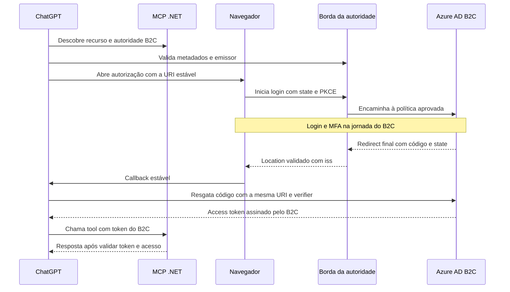

# OAuth do ChatGPT para MCP .NET com emissão exclusiva pelo Azure AD B2C

**Proposta para segurança e homologação · 9 de novembro de 2026**

## 1. Decisão

**O Azure AD B2C é o único emissor de códigos e access tokens.** O ChatGPT usa o cliente OAuth cadastrado no B2C. O investidor continua sujeito à política de autenticação e MFA vigente. O MCP valida o JWT assinado pelo B2C.

**No canal observado pela equipe, o `callback_id` é gerado por sessão e muda após expirar.** Isso elimina o cadastro manual e o provisionamento por publicação como caminhos de produção. Atualizar o cadastro a cada login colocaria a gravação e a visibilidade da URI no B2C no caminho crítico de uma sessão que pode expirar. A decisão independe de estimar a latência de propagação. Manter a validação exata de redirect e recusar IDs de sessão obtidos apenas da requisição do navegador. [RFC 9700 § 4.1.3](https://www.rfc-editor.org/rfc/rfc9700.html#section-4.1.3)

**Próxima decisão de viabilidade.** Avaliar em homologação um adaptador de RFC 9207 como parte da borda da autoridade B2C. Para uma conexão elegível, o ChatGPT escolhe a URI global `https://chatgpt.com/connector_platform_oauth_redirect` antes de abrir o navegador. Essa URI seria cadastrada uma vez no B2C. A borda atuaria nos metadados e na resposta de autorização. A troca do código seguiria pela rota oficial B2C já homologada, sem passar pela regra. Se a Cloudflare já estiver nessa borda de login, a primeira hipótese é configurar metadados estáticos e uma regra de resposta, sem criar serviço de aplicação. [OpenAI, identificação do emissor e callbacks](https://developers.openai.com/plugins/build/auth#protect-callbacks-with-issuer-identification) · [RFC 9207 §§ 2–3](https://www.rfc-editor.org/rfc/rfc9207.html#section-2)

## 2. Fluxo alvo com URI estável



| Mensagem | Contrato |
| --- | --- |
| Descoberta | O Protected Resource Metadata publica o recurso canônico `R` e a autoridade B2C `I`. Os metadados no endereço de descoberta derivado de `I` usam `issuer=I` e `authorization_response_iss_parameter_supported=true` para a autoridade homologada. A troca aponta para o endpoint oficial da mesma autoridade. |
| ChatGPT → B2C, `/authorize` | Cliente dedicado e pré-cadastrado, `response_type=code`, `response_mode=query` efetivo, `redirect_uri=C` com a URI global cadastrada exatamente, `state`, PKCE S256, `resource=R` e os escopos B2C do MCP. O B2C decide autenticação e autorização na política aprovada. |
| B2C → borda → ChatGPT | Após validar a resposta do B2C, a borda acrescenta exatamente um `iss=I` ao retorno para `C`. Preserva código ou erro OAuth e `state`. O ChatGPT compara `iss` com o emissor selecionado antes de chamar `/token`. |
| ChatGPT → B2C, `/token` | `grant_type=authorization_code`, código emitido pelo B2C, `code_verifier`, mesmo `redirect_uri=C`, `resource=R` e autenticação do cliente homologada. Nenhuma tradução de `redirect_uri` nessa rota. |
| B2C → ChatGPT → MCP | O B2C devolve o access token assinado. O MCP valida assinatura, chaves, algoritmo, emissor esperado, política, validade, audiência exclusiva, escopo e cliente conforme o contrato de claims. O MCP e a API de negócio autorizam o objeto do investidor. |

`I` deve coincidir literalmente no Protected Resource Metadata, no `issuer` dos metadados, no `iss` do callback e no emissor do JWT B2C aceito pelo MCP. A Microsoft documenta que o domínio personalizado pode alterar o `iss` dos tokens. Se for necessário um domínio ou uma política dedicada, comprovar o novo valor no B2C e configurar explicitamente o MCP para esse emissor. A claim de um JWT e o parâmetro do callback são evidências distintas. [RFC 8414 § 3.3](https://www.rfc-editor.org/rfc/rfc8414.html#section-3.3) · [Microsoft, domínio personalizado e emissão](https://learn.microsoft.com/en-us/azure/active-directory-b2c/custom-domain#token-issuance) · [B2C, perfil de emissor JWT](https://learn.microsoft.com/en-us/azure/active-directory-b2c/jwt-issuer-technical-profile)

Configurar um cliente Web dedicado e uma identidade de recurso exclusiva para o MCP no B2C. O B2C documenta `aud` como o identificador da aplicação de destino. Usar uma correspondência única e verificável entre `R`, escopos expostos e `aud` do MCP. A RFC 8707 admite o mapeamento para um identificador de audiência distinto. Se o B2C ignorar `resource`, registrar o desvio. Quando o perfil aprovado exigir o tratamento nas duas etapas, o desvio bloqueia a liberação. [B2C, fluxo de código](https://learn.microsoft.com/en-us/azure/active-directory-b2c/authorization-code-flow) · [B2C, claims](https://learn.microsoft.com/en-us/azure/active-directory-b2c/tokens-overview) · [RFC 8707 § 2](https://www.rfc-editor.org/rfc/rfc8707.html#section-2) · [Autorização MCP](https://modelcontextprotocol.io/specification/2026-07-28/basic/authorization)

## 3. Viabilidade e fronteira da borda

| Prova de viabilidade | Condição para avançar |
| --- | --- |
| Autoridade e descoberta | Usar domínio e política B2C homologados. Confirmar controle sobre a descoberta de `I` e sobre os retornos dessa autoridade. Isolar a publicação da extensão em um emissor cuja cobertura possa ser garantida. O anúncio de suporte vale para o emissor. Publicá-lo somente com a transformação ativa e coberta pelo mesmo controle de mudança. |
| Resposta final autêntica | A borda precisa receber a resposta final da política B2C, inclusive após MFA, SSO, federação, cancelamento e erro. No modo `query`, aplicar a extensão somente ao `Location` HTTPS para o destino exato `C`, vindo da origem B2C autenticada. Validar forma e unicidade de `code`, `error`, `state` e `iss`. Exigir exatamente um entre `code` e `error` no retorno OAuth. Rejeitar `iss` conflitante e retorno de autorização para destino fora do contrato. Os redirects intermediários legítimos da jornada B2C e os erros locais seguem seu fluxo aprovado. |
| Troca e credenciais | O endpoint publicado de `/token` usa a rota oficial B2C homologada. Demonstrar por roteamento e traces mascarados que a regra de adaptação não é acionada no resgate e que nenhuma nova terminação TLS ou serviço passa a receber credenciais ou respostas de token. Se a borda atual já termina TLS em `/token`, essa exposição faz parte da linha de base. |
| Comportamento do canal | Em um cadastro de homologação representativo, observar `C` em `/authorize` antes de autenticar e `C` em `/token`. Repetir após expiração de sessão. O JWT deve sair do B2C e passar pela validação do MCP. Confirmar que ausência ou divergência de `iss` impede o resgate. |

Exemplo do resultado de um callback validado, com valores ocultos e `iss` codificado como parâmetro de query.

```http
Location: https://chatgpt.com/connector_platform_oauth_redirect?code=<oculto>&state=<oculto>&iss=<I-codificado>
```

Derivar `I` de configuração homologada e `C` do cadastro fixo. Não usar `Host`, `X-Forwarded-Host` ou um destino fornecido pelo navegador para formar os valores. Restringir e autenticar a origem. Usar `Cache-Control: no-store` e mascarar códigos, tokens e estados em logs e traces. Testar se há caminho alternativo que contorne a adaptação para o emissor anunciado.

### Configuração declarativa sem novo serviço

**Metadados estáticos.** Publicar um JSON versionado no endereço RFC 8414 da autoridade B2C, por uma rota para uma origem estática aprovada. Por exemplo, se o emissor observado for `https://login-hml.empresa.example/tenant/v2.0/`, o caminho de descoberta RFC 8414 é `/.well-known/oauth-authorization-server/tenant/v2.0`. O valor de `issuer` no JSON mantém a barra final. Copiar os endpoints e capacidades efetivas da política B2C, preservar `jwks_uri` e anunciar `authorization_response_iss_parameter_supported: true` em conjunto com a regra de resposta já validada. O Protected Resource Metadata do MCP aponta para esse emissor. Validar qual URL de descoberta o ChatGPT realmente consultou. [RFC 8414 §§ 3.1 e 3.3](https://www.rfc-editor.org/rfc/rfc8414.html#section-3.1) · [Azure Front Door, origem estática](https://learn.microsoft.com/en-us/azure/frontdoor/scenario-storage-blobs)

**Regra de resposta.** Se a Cloudflare já compõe o perímetro autorizado do domínio de login, usar **Response Header Transform Rules**, na fase `http_response_headers_transform`, como primeira prova. A Microsoft documenta Cloudflare → Azure Front Door → B2C para domínio personalizado. A referência da Cloudflare lista o status HTTP e os cabeçalhos da resposta entre os campos que podem ser usados no novo valor. Confirmar disponibilidade do filtro e da ação na zona e no plano contratados. A regra fica limitada à origem B2C autenticada e ao domínio e à política homologados. [Microsoft, Cloudflare com B2C](https://learn.microsoft.com/en-us/azure/active-directory-b2c/partner-cloudflare) · [Cloudflare, campos e funções](https://developers.cloudflare.com/rules/transform/response-header-modification/reference/fields-functions/) · [Cloudflare, regras via API](https://developers.cloudflare.com/rules/transform/response-header-modification/create-api/)

| Filtro ou ação | Contrato de homologação |
| --- | --- |
| Selecionar a resposta | Restringir ao host de login, à rota de autorização e aos status de redirect final observados na jornada B2C, como 302 ou 303. Exigir um único `Location` e a URI global HTTPS exata antes da query. Confirmar a exclusão explícita do endpoint de token, descoberta estática e outras políticas. |
| Validar a query | Validar integralmente os formatos de sucesso e erro observados. Preservar os valores codificados de `code`, `state` e demais campos permitidos. Exercitar nomes duplicados ou codificados de modo ambíguo, presença simultânea de `code` e `error`, `iss` preexistente ou divergente e fragmentos. Um retorno ambíguo fica fora da reescrita e precisa ser rejeitado no teste ponta a ponta. |
| Sobrescrever `Location` | Usar a operação `set` com o valor original seguido de `&iss=` e do emissor codificado, obtido da configuração aprovada. O filtro deve garantir a presença da query antes de aplicar essa expressão. |
| Manter a operação | Provar que os redirects intermediários ficam intactos, que a rota de resgate fica fora da regra e que respostas de autorização não entram no cache. Na Cloudflare, uma alteração de `Cache-Control` na transformação ocorre após a decisão de cache. Configurar o bypass de cache no recurso próprio. |

Exemplo apenas da expressão de valor, com o filtro anterior já aplicado. Validar a regra completa antes de usar a expressão.

```text
concat(http.response.headers["location"][0], "&iss=<I-codificado>")
```

Executar `dry_run=true` na Rulesets API com as permissões da zona, ou usar a validação do painel, para checar campos, expressão, operação `set`, disponibilidade e permissões sem publicar. Depois, executar os cenários em homologação. Se for necessário introduzir a Cloudflare no domínio B2C, a aprovação da topologia deve cobrir a terminação TLS, a renovação do certificado do Front Door e a integridade do IP usado em Acesso Condicional. O caminho do MCP, por si só, não prova presença na autoridade de login. [Cloudflare, concat](https://developers.cloudflare.com/ruleset-engine/rules-language/functions/#concat) · [Cloudflare, validação](https://developers.cloudflare.com/ruleset-engine/rulesets-api/dry-run/) · [Cloudflare, cache e transformações](https://developers.cloudflare.com/rules/transform/response-header-modification/) · [Microsoft, renovação de certificados](https://learn.microsoft.com/en-us/azure/active-directory-b2c/partner-cloudflare#configure-dns) · [Microsoft, IP e Acesso Condicional](https://learn.microsoft.com/en-us/azure/active-directory-b2c/custom-domain#which-ip-address-is-presented-to-azure-ad-b2c-the-users-ip-address-or-the-azure-front-door-ip-address)

**Limite do Front Door isolado.** A Microsoft demonstra como reescrever `Location`. As condições de regras documentadas se baseiam na requisição. Isso não comprova a seleção pelo status e pelo `Location` da resposta final. Já o Application Gateway v2 documenta condições sobre `Location` e captura do cabeçalho em resposta. Ele é candidato quando já integra uma topologia de login aprovada e cobre a jornada. A presença desse recurso no produto não comprova que ele esteja na rota B2C. [Front Door, condições](https://learn.microsoft.com/en-us/azure/frontdoor/rules-match-conditions) · [Front Door, reescrita](https://learn.microsoft.com/en-us/azure/frontdoor/rules-engine-scenarios) · [Application Gateway, condição sobre Location](https://learn.microsoft.com/en-us/azure/application-gateway/rewrite-http-headers-url#modify-a-redirection-url)

### Por que um relay de callback fica fora do desenho

Se a fachada substitui a URI dinâmica `D` por uma URI corporativa `B` em `/authorize`, o código B2C fica vinculado a `B`. O ChatGPT continua enviando `D` para o resgate. O OAuth e o B2C exigem a URI usada na autorização. Fazer esse caminho funcionar exigiria uma fachada no `/token` e uma forma autenticada de vincular `D` à conexão autorizada. Uma validação baseada apenas em `chatgpt.com` e no prefixo do caminho não oferece essa vinculação. O caminho de adaptação RFC 9207 evita a tradução ao fazer o ChatGPT escolher `C` desde a primeira requisição. [RFC 6749 § 4.1.3](https://www.rfc-editor.org/rfc/rfc6749.html#section-4.1.3) · [B2C, resgate do código](https://learn.microsoft.com/en-us/azure/active-directory-b2c/authorization-code-flow#2-get-an-access-token) · [RFC 9700 § 4.1.3](https://www.rfc-editor.org/rfc/rfc9700.html#section-4.1.3)

**Decisão em caso de bloqueio.** Se IAM e a equipe de borda não puderem isolar a resposta de autorização em uma topologia suportada, ou se o ChatGPT seguir escolhendo a URI por sessão no canal alvo, a ponte fica bloqueada para produção com as fronteiras atuais. A Transmit deve passar pelo mesmo teste de descoberta, URI, emissor e resgate antes de assumir o conector.

## 4. Paridade e ganho de segurança

A linha de base é a configuração efetiva do B2C hoje. Inventariar a política publicada e sua versão, MFA, sessões SSO, bloqueio de conta, elegibilidade, app registrations, chaves, proteção de rede, revogação, auditoria e indicadores de operação. Usar um cliente de referência cadastrado e dados sintéticos quando o vínculo direto com ChatGPT ainda estiver bloqueado. Comparar o mesmo controle com as mesmas condições de teste na solução candidata. [Microsoft, MFA no B2C](https://learn.microsoft.com/en-us/azure/active-directory-b2c/multi-factor-authentication) · [Microsoft, SSO de custom policies](https://learn.microsoft.com/en-us/azure/active-directory-b2c/custom-policy-reference-sso) · [Microsoft, logs B2C](https://learn.microsoft.com/en-us/azure/active-directory-b2c/view-audit-logs)

| Controle | Critério de paridade ou ganho |
| --- | --- |
| Autenticação e MFA | O B2C recebe e verifica as credenciais pela política aprovada. Manter os fatores, a política e a idade de sessão permitida. Exercitar sessão nova, sessão reaproveitada, tentativa pela política errada, conta bloqueada e ausência de elegibilidade. No B2C, `auth_time` isolado não diferencia um MFA novo de SSO. |
| Emissão e confiança | O MCP valida somente access tokens do emissor B2C previsto, com assinatura válida, audiência exclusiva, política e cliente permitidos. Verificar `tfp` ou `acr`, e `azp`, conforme as claims efetivamente emitidas e exigidas no contrato. Validar também `exp`, `nbf` quando presente, `scp`, e mapear o investidor por identidade estável. O plano de dados não tem permissões de assinatura nem de alteração no B2C. |
| Autorização e revogação | Vincular autorização e consentimento ao investidor, cliente, recurso e escopo. O MCP e a API de negócio autorizam o objeto em cada chamada. Usar a fonte corporativa de autorização vigente para recusar um grant revogado, inclusive durante o TTL do JWT. Provar o tempo entre a confirmação da revogação e o bloqueio da primeira decisão posterior. A revogação iniciada no B2C tem prazo próprio de propagação, medido de ponta a ponta. |
| Borda e operação | Preservar trilha de IAM até a decisão da API, sem segredo, código ou token nos logs. Medir latência p95/p99, disponibilidade, recuperação e revogação nos limites aprovados. Exercitar rotação de chaves e bloqueio de acesso quando a validação necessária falha. Quando houver adaptador, provar que não existe acesso alternativo que burle seus controles. |

Um ganho deve corresponder a uma redução observada de risco. Exemplos são restringir a audiência a uma única API e bloquear um JWT ainda válido após revogação confirmada, se a linha de base permitir reutilização nesses casos. mTLS na borda autentica a conexão. A prova de posse exige um vínculo com o token emitido e a sua validação por chamada, como na RFC 8705. Se ASVS 5.0.0 nível 3 ou FAPI 2.0 for exigido no escopo, PAR, autenticação assimétrica e prova de posse precisam de evidência no B2C, no ChatGPT e no MCP, conforme o papel de cada componente. Trocar o callback preserva a emissão original e não adiciona essas capacidades ao JWT. [RFC 8705 § 3](https://www.rfc-editor.org/rfc/rfc8705.html#section-3) · [OWASP ASVS 5.0.0, capítulo V10](https://github.com/OWASP/ASVS/blob/v5.0.0/5.0/en/0x19-V10-OAuth-and-OIDC.md) · [FAPI 2.0](https://openid.net/specs/fapi-security-profile-2_0.html) · [NIST SP 800-207A](https://csrc.nist.gov/pubs/sp/800/207/a/final)

A matriz atende à avaliação técnica do fluxo. Compliance valida o enquadramento da CMN 4.893/2021 e CMN 5.274/2025, ou da CVM 135 para a entidade administradora de mercado organizado, conforme atividade e entidade. Segurança ratifica o perfil OWASP e aprova as evidências. Privacidade e Negócio aprovam os dados e a finalidade do envio ao ChatGPT. O Open Finance Brasil é referência setorial e tem escopo regulatório próprio. [CMN 5.274](https://www.bcb.gov.br/estabilidadefinanceira/exibenormativo?tipo=Resolu%C3%A7%C3%A3o+CMN&numero=5274) · [CVM 135, arts. 110–111](https://conteudo.cvm.gov.br/export/sites/cvm/legislacao/resolucoes/anexos/100/resol135consolid.pdf) · [Manual do Open Finance Brasil](https://www.bcb.gov.br/estabilidadefinanceira/exibenormativo?tipo=Instru%C3%A7%C3%A3o+Normativa+BCB&numero=720) · [OpenAI, dados em plugins](https://developers.openai.com/plugins/plugin-guidelines)

## 5. Homologação e testes adversariais

**Primeiro teste.** Validar a configuração da regra sem publicar. Com usuário e dados sintéticos, confirmar que a borda aprovada recebe o `Location` final do B2C em sucesso, cancelamento e erro, distingue os redirects intermediários e mantém `/token` fora da regra. Usar cliente de referência e redirect de homologação antes de anunciar RFC 9207.

**Segundo teste.** Com a extensão publicada para a autoridade isolada e a URI global cadastrada no B2C, usar o canal ChatGPT real. Confirmar `C` no `/authorize` e no `/token` e repetir após expiração da sessão. Observar `iss`, escopos, `resource`, PKCE, o caminho de resgate e a audiência efetiva em traces mascarados. Se o ChatGPT seguir usando `callback_id`, bloquear a promoção do desenho.

Executar os casos negativos em homologação autorizada com a topologia da entrega, incluindo o Axway onde ele está no caminho. Para cada mutação, confirmar primeiro o fluxo válido com o mesmo cliente, política e controles. Usar o ChatGPT real nos cenários que dependem de seu comportamento e um cliente de referência para variar parâmetros e provocar condições concorrentes. Em cada execução registrar configuração, imagem ou versão, caso, condição alterada, decisão, motivo, correlação e efeito observado no AS, no MCP e na API de negócio. Recusar um acesso exige comprovar também a ausência de emissão, execução ou vazamento indevido no ponto relevante.

| Caso | Ataque e critério de aceite |
| --- | --- |
| SEG-01 · Redirect | Trocar a URI global por um callback por sessão no mesmo domínio, host semelhante, porta, barra, query extra ou codificação ambígua. Simular um `Location` OAuth divergente da URI global ou com parâmetros duplicados. O B2C recusa a URI não cadastrada. A borda recusa o retorno OAuth divergente e preserva os redirects intermediários legítimos. |
| SEG-02 · MFA, SSO e política | Usar sessão reaproveitada, política de MFA inferior, conta bloqueada e login B2C válido sem elegibilidade. A decisão do candidato deve aplicar a mesma política e condições da linha de base. Token assinado por outra política deve ser recusado pelo MCP mesmo se a assinatura for legítima. |
| SEG-03 · Injeção de código e CSRF | Cruzar códigos, verificadores e estados de duas transações, omitir PKCE e trocar por `plain`. Usar o cliente correto para isolar o erro. No resgate, trocar apenas a URI. Confirmar que nenhum token indevido é emitido e nenhum vínculo é atribuído à conta errada. Se o B2C não exigir PKCE nesse registro, avaliar o desvio perante a política de segurança. |
| SEG-04 · Replay e concorrência | Tentar resgatar o mesmo código em paralelo com requisições válidas. No máximo um resgate pode emitir token. Verificar o destino do token já emitido diante do reuso válido do código conforme o perfil ratificado. Testar a perda da resposta do B2C e a recuperação por nova autorização. |
| SEG-05 · Mix-up e RFC 9207 | Fixar issuer, política e endpoints. Omitir e adulterar `iss` em respostas de teste, inclusive tentativa de forjar por cabeçalhos. O ChatGPT deve recusar ausência ou divergência antes de chamar `/token`. A borda rejeita duplicidade. Testar sucesso, cancelamento e erros com redirect validado e tentativa de contornar a borda. |
| SEG-06 · Confusão de token e audiência | Apresentar ID token, JWT com assinatura inválida, token expirado e access token genuíno de outro aplicativo, cliente, tenant, ambiente, escopo ou política. Variar `resource` no `/authorize` e no `/token` separadamente. Confirmar que o MCP recusa credenciais fora do contrato e registrar o comportamento do B2C para `resource` omitido, repetido ou divergente. |
| SEG-07 · Acesso a outro investidor | Com o access token correto do investidor A, solicitar objeto, paginação ou dados do investidor B. Confirmar a recusa no MCP e na API de negócio, sem retornar linhas ou metadados de B. Usar as autorizações legítimas de A e B como controles positivos. |
| SEG-08 · Token roubado e gateway | Testar um token capturado fora do caminho autorizado, acesso direto, `Host` e cabeçalhos de proxy ou certificado forjados. Se for exigida prova de posse, testar o mesmo token sem a prova e com outro certificado válido da mesma cadeia. Ausência de vínculo verificável mantém o requisito pendente. |
| SEG-09 · Revogação e indisponibilidade | Revogar com JWT ainda válido e confirmar recusa na próxima decisão após o commit, em todas as réplicas. Medir separadamente alterações vindas do B2C. Derrubar a fonte de autorização e a rota do IdP para validar recusa de operações cuja verificação esteja indisponível, sem criar fallback permissivo. Ensaiar rotação e desligamento de emergência. |
| SEG-10 · Sigilo e credenciais | Inserir marcadores sintéticos em códigos e tokens. Procurar ocorrências em logs, WAF, traces, métricas, referer e erros. Verificar que o adaptador não recebe resgate, credencial do cliente ou resposta de token e não consegue alterar o cadastro B2C, ler chaves de assinatura ou acessar a API de negócio. Simular captura do código de autorização e medir o impacto conforme o modelo de ameaças. |

Referências para o catálogo de ataques e o método de verificação. [OAuth Security BCP, RFC 9700](https://www.rfc-editor.org/rfc/rfc9700.html) · [JWT BCP, RFC 8725](https://www.rfc-editor.org/rfc/rfc8725.html) · [MCP, práticas de segurança](https://modelcontextprotocol.io/docs/2026-07-28/tutorials/security/security_best_practices) · [OWASP API1:2023, autorização por objeto](https://api-security.owasp.org/editions/2023/en/0xa1-broken-object-level-authorization/) · [NIST SP 800-115, avaliação de segurança](https://csrc.nist.gov/pubs/sp/800/115/final)

**Critérios de liberação.** Aprovar todos os testes bloqueantes do perfil acordado e obter zero aceitações indevidas observadas e zero achados altos ou críticos abertos no fluxo, com pentest independente e reteste. Comparar com a linha de base e registrar as diferenças, inclusive disponibilidade, tempo de revogação e alcance de comprometimento. A aprovação de um conector em homologação com dados sintéticos não aprova tratamento de dados reais. Em caso de dúvida sobre a identidade da conexão, sobre a origem do token ou sobre a política aplicada, manter o fluxo restrito à homologação.

## 6. Migração e retirada

Homologar a Transmit com o canal real, comparando issuer nos metadados e no callback, escolha da URI, autenticação do cliente, PKCE, audiência, escopos, política de MFA, revogação e requisitos do perfil ratificado. Planejar novo vínculo e consentimento quando necessário, sem tratar sujeitos de dois emissores como equivalentes sem mapeamento interno aprovado. No corte, revogar os vínculos e credenciais do B2C destinados ao conector, remover URIs obsoletas e desligar qualquer adaptação temporária. [Transmit, fluxo PKCE](https://developer.transmitsecurity.com/guides/user/auth_oidc_pkce) · [OpenAI, publicação e vínculo](https://developers.openai.com/plugins/deploy/submission#configure-authentication-for-submission)

## 7. Revisão do desenho

| Rodada | Conclusão aplicada |
| --- | --- |
| 1. Emissão e cadastro | A rotação por sessão observada elimina o cadastro recorrente. A assinatura e a emissão ficam no B2C e a PoC verifica a escolha da URI global. |
| 2. Consistência OAuth | A troca exige o mesmo redirect da autorização. Adaptar só o retorno de um código emitido para outra URI não conclui o fluxo. |
| 3. Fronteira de confiança | A regra declarativa precisa usar a resposta final observada. A referência da Cloudflare documenta os campos necessários, com validação e testes na zona de login ainda pendentes. |
| 4. Paridade e saída | A segurança é avaliada contra a configuração efetiva do B2C, com ataques negativos e controles positivos, e reavaliada no corte para a Transmit. |

**Evidência atual.** O desenho e os contratos foram revisados contra a documentação pública. A rotação por sessão no fluxo atual foi informada pela equipe. As referências de produto sustentam a prova de uma adaptação declarativa. A configuração na zona de login, a escolha da URI estável pelo ChatGPT, o resgate no B2C e os testes adversariais permanecem pendentes de homologação.
