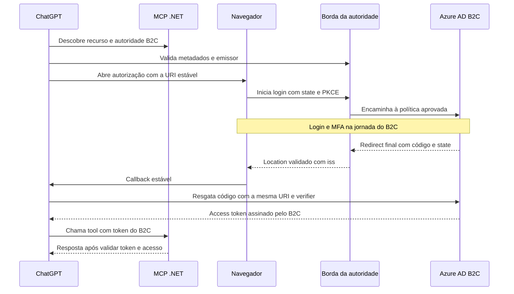
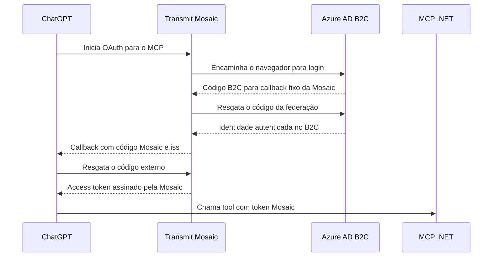

# OAuth do ChatGPT para MCP .NET com emissão exclusiva pelo Azure AD B2C

**Proposta para segurança e homologação · 9 de novembro de 2026**

## 1. Decisão

**O Azure AD B2C é o único emissor de códigos e access tokens.** O ChatGPT usa o cliente OAuth cadastrado no B2C. O investidor continua sujeito à política de autenticação e MFA vigente. O MCP valida o JWT assinado pelo B2C.

**No canal observado pela equipe, o `callback_id` é gerado por sessão e muda após expirar.** Isso elimina o cadastro manual e o provisionamento por publicação como caminhos de produção. Atualizar o cadastro a cada login colocaria a gravação e a visibilidade da URI no B2C no caminho crítico de uma sessão que pode expirar. A decisão independe de estimar a latência de propagação. Manter a validação exata de redirect e recusar IDs de sessão obtidos apenas da requisição do navegador. [RFC 9700 § 4.1.3](https://www.rfc-editor.org/rfc/rfc9700.html#section-4.1.3)

**Próxima decisão de viabilidade.** Avaliar em homologação um adaptador de RFC 9207 como parte da borda da autoridade B2C. Para uma conexão elegível, o ChatGPT escolhe a URI global `https://chatgpt.com/connector_platform_oauth_redirect` antes de abrir o navegador. Essa URI seria cadastrada uma vez no B2C. A borda atuaria nos metadados e na resposta de autorização. A troca do código seguiria pela rota oficial B2C já homologada, sem passar pela regra. Se a Cloudflare já estiver nessa borda de login, a primeira hipótese é configurar metadados estáticos e uma regra de resposta, sem criar serviço de aplicação. [OpenAI, identificação do emissor e callbacks](https://developers.openai.com/plugins/build/auth#protect-callbacks-with-issuer-identification) · [RFC 9207 §§ 2–3](https://www.rfc-editor.org/rfc/rfc9207.html#section-2)

## 2. Fluxo alvo com URI estável



| Mensagem | Contrato |
| --- | --- |
| Descoberta | O Protected Resource Metadata publica o recurso canônico `R` e a autoridade B2C `I`. Os metadados no endereço de descoberta derivado de `I` usam `issuer=I` e `authorization_response_iss_parameter_supported=true` para a autoridade homologada. A troca aponta para o endpoint oficial da mesma autoridade. |
| ChatGPT → B2C, `/authorize` | Cliente dedicado e pré-cadastrado, `response_type=code`, `response_mode=query` efetivo, `redirect_uri=C` com a URI global cadastrada exatamente, `state`, PKCE S256, `resource=R` e os escopos B2C do MCP. O B2C decide autenticação e autorização na política aprovada. |
| B2C → borda → ChatGPT | Após validar a resposta do B2C, a borda acrescenta exatamente um `iss=I` ao retorno para `C`. Preserva código ou erro OAuth e `state`. O ChatGPT compara `iss` com o emissor selecionado antes de chamar `/token`. |
| ChatGPT → B2C, `/token` | `grant_type=authorization_code`, código emitido pelo B2C, `code_verifier`, mesmo `redirect_uri=C`, `resource=R` e autenticação do cliente homologada. Nenhuma tradução de `redirect_uri` nessa rota. |
| B2C → ChatGPT → MCP | O B2C devolve o access token assinado. O MCP valida assinatura, chaves, algoritmo, emissor esperado, política, validade, audiência exclusiva, escopo e cliente conforme o contrato de claims. O MCP e a API de negócio autorizam o objeto do investidor. |

`I` deve coincidir literalmente no Protected Resource Metadata, no `issuer` dos metadados, no `iss` do callback e no emissor do JWT B2C aceito pelo MCP. A Microsoft documenta que o domínio personalizado pode alterar o `iss` dos tokens. Se for necessário um domínio ou uma política dedicada, comprovar o novo valor no B2C e configurar explicitamente o MCP para esse emissor. A claim de um JWT e o parâmetro do callback são evidências distintas. [RFC 8414 § 3.3](https://www.rfc-editor.org/rfc/rfc8414.html#section-3.3) · [Microsoft, domínio personalizado e emissão](https://learn.microsoft.com/en-us/azure/active-directory-b2c/custom-domain#token-issuance) · [B2C, perfil de emissor JWT](https://learn.microsoft.com/en-us/azure/active-directory-b2c/jwt-issuer-technical-profile)

Configurar um cliente Web dedicado e uma identidade de recurso exclusiva para o MCP no B2C. O B2C documenta `aud` como o identificador da aplicação de destino. Usar uma correspondência única e verificável entre `R`, escopos expostos e `aud` do MCP. A RFC 8707 admite o mapeamento para um identificador de audiência distinto. Se o B2C ignorar `resource`, registrar o desvio. Quando o perfil aprovado exigir o tratamento nas duas etapas, o desvio bloqueia a liberação. [B2C, fluxo de código](https://learn.microsoft.com/en-us/azure/active-directory-b2c/authorization-code-flow) · [B2C, claims](https://learn.microsoft.com/en-us/azure/active-directory-b2c/tokens-overview) · [RFC 8707 § 2](https://www.rfc-editor.org/rfc/rfc8707.html#section-2) · [Autorização MCP](https://modelcontextprotocol.io/specification/2026-07-28/basic/authorization)

## 3. Viabilidade e fronteira da borda

| Prova de viabilidade | Condição para avançar |
| --- | --- |
| Autoridade e descoberta | Usar domínio e política B2C homologados. Confirmar controle sobre a descoberta de `I` e sobre os retornos dessa autoridade. Isolar a publicação da extensão em um emissor cuja cobertura possa ser garantida. O anúncio de suporte vale para o emissor. Publicá-lo somente com a transformação ativa e coberta pelo mesmo controle de mudança. |
| Resposta final autêntica | A borda precisa receber a resposta final da política B2C, inclusive após MFA, SSO, federação, cancelamento e erro. No modo `query`, aplicar a extensão somente ao `Location` HTTPS para o destino exato `C`, vindo da origem B2C autenticada. Validar forma e unicidade de `code`, `error`, `state` e `iss`. Exigir exatamente um entre `code` e `error` no retorno OAuth. Rejeitar `iss` conflitante e retorno de autorização para destino fora do contrato. Os redirects intermediários legítimos da jornada B2C e os erros locais seguem seu fluxo aprovado. |
| Troca e credenciais | O endpoint publicado de `/token` usa a rota oficial B2C homologada. Demonstrar por roteamento e traces mascarados que a regra de adaptação não é acionada no resgate e que nenhuma nova terminação TLS ou serviço passa a receber credenciais ou respostas de token. Se a borda atual já termina TLS em `/token`, essa exposição faz parte da linha de base. |
| Comportamento do canal | Em um cadastro de homologação representativo, observar `C` em `/authorize` antes de autenticar e `C` em `/token`. Repetir após expiração de sessão. O JWT deve sair do B2C e passar pela validação do MCP. Confirmar que ausência ou divergência de `iss` impede o resgate. |

Exemplo do resultado de um callback validado, com valores ocultos e `iss` codificado como parâmetro de query.

```http
Location: https://chatgpt.com/connector_platform_oauth_redirect?code=<oculto>&state=<oculto>&iss=<I-codificado>
```

Derivar `I` de configuração homologada e `C` do cadastro fixo. Não usar `Host`, `X-Forwarded-Host` ou um destino fornecido pelo navegador para formar os valores. Restringir e autenticar a origem. Usar `Cache-Control: no-store` e mascarar códigos, tokens e estados em logs e traces. Testar se há caminho alternativo que contorne a adaptação para o emissor anunciado.

### Configuração declarativa sem novo serviço

**Metadados estáticos.** Publicar um JSON versionado no endereço RFC 8414 da autoridade B2C, por uma rota para uma origem estática aprovada. Por exemplo, se o emissor observado for `https://login-hml.empresa.example/tenant/v2.0/`, o caminho de descoberta RFC 8414 é `/.well-known/oauth-authorization-server/tenant/v2.0`. O valor de `issuer` no JSON mantém a barra final. Copiar os endpoints e capacidades efetivas da política B2C, preservar `jwks_uri` e anunciar `authorization_response_iss_parameter_supported: true` em conjunto com a regra de resposta já validada. O Protected Resource Metadata do MCP aponta para esse emissor. Validar qual URL de descoberta o ChatGPT realmente consultou. [RFC 8414 §§ 3.1 e 3.3](https://www.rfc-editor.org/rfc/rfc8414.html#section-3.1) · [Azure Front Door, origem estática](https://learn.microsoft.com/en-us/azure/frontdoor/scenario-storage-blobs)

**Regra de resposta.** Se a Cloudflare já compõe o perímetro autorizado do domínio de login, usar **Response Header Transform Rules**, na fase `http_response_headers_transform`, como primeira prova. A Microsoft documenta Cloudflare → Azure Front Door → B2C para domínio personalizado. A referência da Cloudflare lista o status HTTP e os cabeçalhos da resposta entre os campos que podem ser usados no novo valor. Confirmar disponibilidade do filtro e da ação na zona e no plano contratados. A regra fica limitada à origem B2C autenticada e ao domínio e à política homologados. [Microsoft, Cloudflare com B2C](https://learn.microsoft.com/en-us/azure/active-directory-b2c/partner-cloudflare) · [Cloudflare, campos e funções](https://developers.cloudflare.com/rules/transform/response-header-modification/reference/fields-functions/) · [Cloudflare, regras via API](https://developers.cloudflare.com/rules/transform/response-header-modification/create-api/)

| Filtro ou ação | Contrato de homologação |
| --- | --- |
| Selecionar a resposta | Restringir ao host de login, à rota de autorização e aos status de redirect final observados na jornada B2C, como 302 ou 303. Exigir um único `Location` e a URI global HTTPS exata antes da query. Confirmar a exclusão explícita do endpoint de token, descoberta estática e outras políticas. |
| Validar a query | Validar integralmente os formatos de sucesso e erro observados. Preservar os valores codificados de `code`, `state` e demais campos permitidos. Exercitar nomes duplicados ou codificados de modo ambíguo, presença simultânea de `code` e `error`, `iss` preexistente ou divergente e fragmentos. Um retorno ambíguo fica fora da reescrita e precisa ser rejeitado no teste ponta a ponta. |
| Sobrescrever `Location` | Usar a operação `set` com o valor original seguido de `&iss=` e do emissor codificado, obtido da configuração aprovada. O filtro deve garantir a presença da query antes de aplicar essa expressão. |
| Manter a operação | Provar que os redirects intermediários ficam intactos, que a rota de resgate fica fora da regra e que respostas de autorização não entram no cache. Na Cloudflare, uma alteração de `Cache-Control` na transformação ocorre após a decisão de cache. Configurar o bypass de cache no recurso próprio. |

Exemplo apenas da expressão de valor, com o filtro anterior já aplicado. Validar a regra completa antes de usar a expressão.

```text
concat(http.response.headers["location"][0], "&iss=<I-codificado>")
```

Executar `dry_run=true` na Rulesets API com as permissões da zona, ou usar a validação do painel, para checar campos, expressão, operação `set`, disponibilidade e permissões sem publicar. Depois, executar os cenários em homologação. Se for necessário introduzir a Cloudflare no domínio B2C, a aprovação da topologia deve cobrir a terminação TLS, a renovação do certificado do Front Door e a integridade do IP usado em Acesso Condicional. O caminho do MCP, por si só, não prova presença na autoridade de login. [Cloudflare, concat](https://developers.cloudflare.com/ruleset-engine/rules-language/functions/#concat) · [Cloudflare, validação](https://developers.cloudflare.com/ruleset-engine/rulesets-api/dry-run/) · [Cloudflare, cache e transformações](https://developers.cloudflare.com/rules/transform/response-header-modification/) · [Microsoft, renovação de certificados](https://learn.microsoft.com/en-us/azure/active-directory-b2c/partner-cloudflare#configure-dns) · [Microsoft, IP e Acesso Condicional](https://learn.microsoft.com/en-us/azure/active-directory-b2c/custom-domain#which-ip-address-is-presented-to-azure-ad-b2c-the-users-ip-address-or-the-azure-front-door-ip-address)

**Limite do Front Door isolado.** A Microsoft demonstra como reescrever `Location`. As condições de regras documentadas se baseiam na requisição. Isso não comprova a seleção pelo status e pelo `Location` da resposta final. Já o Application Gateway v2 documenta condições sobre `Location` e captura do cabeçalho em resposta. Ele é candidato quando já integra uma topologia de login aprovada e cobre a jornada. A presença desse recurso no produto não comprova que ele esteja na rota B2C. [Front Door, condições](https://learn.microsoft.com/en-us/azure/frontdoor/rules-match-conditions) · [Front Door, reescrita](https://learn.microsoft.com/en-us/azure/frontdoor/rules-engine-scenarios) · [Application Gateway, condição sobre Location](https://learn.microsoft.com/en-us/azure/application-gateway/rewrite-http-headers-url#modify-a-redirection-url)

### Por que um relay de callback fica fora do desenho

Se a fachada substitui a URI dinâmica `D` por uma URI corporativa `B` em `/authorize`, o código B2C fica vinculado a `B`. O ChatGPT continua enviando `D` para o resgate. O OAuth e o B2C exigem a URI usada na autorização. Fazer esse caminho funcionar exigiria uma fachada no `/token` e uma forma autenticada de vincular `D` à conexão autorizada. Uma validação baseada apenas em `chatgpt.com` e no prefixo do caminho não oferece essa vinculação. O caminho de adaptação RFC 9207 evita a tradução ao fazer o ChatGPT escolher `C` desde a primeira requisição. [RFC 6749 § 4.1.3](https://www.rfc-editor.org/rfc/rfc6749.html#section-4.1.3) · [B2C, resgate do código](https://learn.microsoft.com/en-us/azure/active-directory-b2c/authorization-code-flow#2-get-an-access-token) · [RFC 9700 § 4.1.3](https://www.rfc-editor.org/rfc/rfc9700.html#section-4.1.3)

**Decisão em caso de bloqueio.** Se IAM e a equipe de borda não puderem isolar a resposta de autorização em uma topologia suportada, ou se o ChatGPT seguir escolhendo a URI por sessão no canal alvo, a ponte fica bloqueada para produção com as fronteiras atuais. A Transmit deve passar pelo mesmo teste de descoberta, URI, emissor e resgate antes de assumir o conector.

## 4. Paridade e ganho de segurança

A linha de base é a configuração efetiva do B2C hoje. Inventariar a política publicada e sua versão, MFA, sessões SSO, bloqueio de conta, elegibilidade, app registrations, chaves, proteção de rede, revogação, auditoria e indicadores de operação. Usar um cliente de referência cadastrado e dados sintéticos quando o vínculo direto com ChatGPT ainda estiver bloqueado. Comparar o mesmo controle com as mesmas condições de teste na solução candidata. [Microsoft, MFA no B2C](https://learn.microsoft.com/en-us/azure/active-directory-b2c/multi-factor-authentication) · [Microsoft, SSO de custom policies](https://learn.microsoft.com/en-us/azure/active-directory-b2c/custom-policy-reference-sso) · [Microsoft, logs B2C](https://learn.microsoft.com/en-us/azure/active-directory-b2c/view-audit-logs)

| Controle | Critério de paridade ou ganho |
| --- | --- |
| Autenticação e MFA | O B2C recebe e verifica as credenciais pela política aprovada. Manter os fatores, a política e a idade de sessão permitida. Exercitar sessão nova, sessão reaproveitada, tentativa pela política errada, conta bloqueada e ausência de elegibilidade. No B2C, `auth_time` isolado não diferencia um MFA novo de SSO. |
| Emissão e confiança | O MCP valida somente access tokens do emissor B2C previsto, com assinatura válida, audiência exclusiva, política e cliente permitidos. Verificar `tfp` ou `acr`, e `azp`, conforme as claims efetivamente emitidas e exigidas no contrato. Validar também `exp`, `nbf` quando presente, `scp`, e mapear o investidor por identidade estável. O plano de dados não tem permissões de assinatura nem de alteração no B2C. |
| Autorização e revogação | Vincular autorização e consentimento ao investidor, cliente, recurso e escopo. O MCP e a API de negócio autorizam o objeto em cada chamada. Usar a fonte corporativa de autorização vigente para recusar um grant revogado, inclusive durante o TTL do JWT. Provar o tempo entre a confirmação da revogação e o bloqueio da primeira decisão posterior. A revogação iniciada no B2C tem prazo próprio de propagação, medido de ponta a ponta. |
| Borda e operação | Preservar trilha de IAM até a decisão da API, sem segredo, código ou token nos logs. Medir latência p95/p99, disponibilidade, recuperação e revogação nos limites aprovados. Exercitar rotação de chaves e bloqueio de acesso quando a validação necessária falha. Quando houver adaptador, provar que não existe acesso alternativo que burle seus controles. |

Um ganho deve corresponder a uma redução observada de risco. Exemplos são restringir a audiência a uma única API e bloquear um JWT ainda válido após revogação confirmada, se a linha de base permitir reutilização nesses casos. mTLS na borda autentica a conexão. A prova de posse exige um vínculo com o token emitido e a sua validação por chamada, como na RFC 8705. Se ASVS 5.0.0 nível 3 ou FAPI 2.0 for exigido no escopo, PAR, autenticação assimétrica e prova de posse precisam de evidência no B2C, no ChatGPT e no MCP, conforme o papel de cada componente. Trocar o callback preserva a emissão original e não adiciona essas capacidades ao JWT. [RFC 8705 § 3](https://www.rfc-editor.org/rfc/rfc8705.html#section-3) · [OWASP ASVS 5.0.0, capítulo V10](https://github.com/OWASP/ASVS/blob/v5.0.0/5.0/en/0x19-V10-OAuth-and-OIDC.md) · [FAPI 2.0](https://openid.net/specs/fapi-security-profile-2_0.html) · [NIST SP 800-207A](https://csrc.nist.gov/pubs/sp/800/207/a/final)

A matriz atende à avaliação técnica do fluxo. Compliance valida o enquadramento da CMN 4.893/2021 e CMN 5.274/2025, ou da CVM 135 para a entidade administradora de mercado organizado, conforme atividade e entidade. Segurança ratifica o perfil OWASP e aprova as evidências. Privacidade e Negócio aprovam os dados e a finalidade do envio ao ChatGPT. O Open Finance Brasil é referência setorial e tem escopo regulatório próprio. [CMN 5.274](https://www.bcb.gov.br/estabilidadefinanceira/exibenormativo?tipo=Resolu%C3%A7%C3%A3o+CMN&numero=5274) · [CVM 135, arts. 110–111](https://conteudo.cvm.gov.br/export/sites/cvm/legislacao/resolucoes/anexos/100/resol135consolid.pdf) · [Manual do Open Finance Brasil](https://www.bcb.gov.br/estabilidadefinanceira/exibenormativo?tipo=Instru%C3%A7%C3%A3o+Normativa+BCB&numero=720) · [OpenAI, dados em plugins](https://developers.openai.com/plugins/plugin-guidelines)

## 5. Homologação e testes adversariais

**Primeiro teste.** Validar a configuração da regra sem publicar. Com usuário e dados sintéticos, confirmar que a borda aprovada recebe o `Location` final do B2C em sucesso, cancelamento e erro, distingue os redirects intermediários e mantém `/token` fora da regra. Usar cliente de referência e redirect de homologação antes de anunciar RFC 9207.

**Segundo teste.** Com a extensão publicada para a autoridade isolada e a URI global cadastrada no B2C, usar o canal ChatGPT real. Confirmar `C` no `/authorize` e no `/token` e repetir após expiração da sessão. Observar `iss`, escopos, `resource`, PKCE, o caminho de resgate e a audiência efetiva em traces mascarados. Se o ChatGPT seguir usando `callback_id`, bloquear a promoção do desenho.

Executar os casos negativos em homologação autorizada com a topologia da entrega, incluindo o Axway onde ele está no caminho. Para cada mutação, confirmar primeiro o fluxo válido com o mesmo cliente, política e controles. Usar o ChatGPT real nos cenários que dependem de seu comportamento e um cliente de referência para variar parâmetros e provocar condições concorrentes. Em cada execução registrar configuração, imagem ou versão, caso, condição alterada, decisão, motivo, correlação e efeito observado no AS, no MCP e na API de negócio. Recusar um acesso exige comprovar também a ausência de emissão, execução ou vazamento indevido no ponto relevante.

| Caso | Ataque e critério de aceite |
| --- | --- |
| SEG-01 · Redirect | Trocar a URI global por um callback por sessão no mesmo domínio, host semelhante, porta, barra, query extra ou codificação ambígua. Simular um `Location` OAuth divergente da URI global ou com parâmetros duplicados. O B2C recusa a URI não cadastrada. A borda recusa o retorno OAuth divergente e preserva os redirects intermediários legítimos. |
| SEG-02 · MFA, SSO e política | Usar sessão reaproveitada, política de MFA inferior, conta bloqueada e login B2C válido sem elegibilidade. A decisão do candidato deve aplicar a mesma política e condições da linha de base. Token assinado por outra política deve ser recusado pelo MCP mesmo se a assinatura for legítima. |
| SEG-03 · Injeção de código e CSRF | Cruzar códigos, verificadores e estados de duas transações, omitir PKCE e trocar por `plain`. Usar o cliente correto para isolar o erro. No resgate, trocar apenas a URI. Confirmar que nenhum token indevido é emitido e nenhum vínculo é atribuído à conta errada. Se o B2C não exigir PKCE nesse registro, avaliar o desvio perante a política de segurança. |
| SEG-04 · Replay e concorrência | Tentar resgatar o mesmo código em paralelo com requisições válidas. No máximo um resgate pode emitir token. Verificar o destino do token já emitido diante do reuso válido do código conforme o perfil ratificado. Testar a perda da resposta do B2C e a recuperação por nova autorização. |
| SEG-05 · Mix-up e RFC 9207 | Fixar issuer, política e endpoints. Omitir e adulterar `iss` em respostas de teste, inclusive tentativa de forjar por cabeçalhos. O ChatGPT deve recusar ausência ou divergência antes de chamar `/token`. A borda rejeita duplicidade. Testar sucesso, cancelamento e erros com redirect validado e tentativa de contornar a borda. |
| SEG-06 · Confusão de token e audiência | Apresentar ID token, JWT com assinatura inválida, token expirado e access token genuíno de outro aplicativo, cliente, tenant, ambiente, escopo ou política. Variar `resource` no `/authorize` e no `/token` separadamente. Confirmar que o MCP recusa credenciais fora do contrato e registrar o comportamento do B2C para `resource` omitido, repetido ou divergente. |
| SEG-07 · Acesso a outro investidor | Com o access token correto do investidor A, solicitar objeto, paginação ou dados do investidor B. Confirmar a recusa no MCP e na API de negócio, sem retornar linhas ou metadados de B. Usar as autorizações legítimas de A e B como controles positivos. |
| SEG-08 · Token roubado e gateway | Testar um token capturado fora do caminho autorizado, acesso direto, `Host` e cabeçalhos de proxy ou certificado forjados. Se for exigida prova de posse, testar o mesmo token sem a prova e com outro certificado válido da mesma cadeia. Ausência de vínculo verificável mantém o requisito pendente. |
| SEG-09 · Revogação e indisponibilidade | Revogar com JWT ainda válido e confirmar recusa na próxima decisão após o commit, em todas as réplicas. Medir separadamente alterações vindas do B2C. Derrubar a fonte de autorização e a rota do IdP para validar recusa de operações cuja verificação esteja indisponível, sem criar fallback permissivo. Ensaiar rotação e desligamento de emergência. |
| SEG-10 · Sigilo e credenciais | Inserir marcadores sintéticos em códigos e tokens. Procurar ocorrências em logs, WAF, traces, métricas, referer e erros. Verificar que o adaptador não recebe resgate, credencial do cliente ou resposta de token e não consegue alterar o cadastro B2C, ler chaves de assinatura ou acessar a API de negócio. Simular captura do código de autorização e medir o impacto conforme o modelo de ameaças. |

Referências para o catálogo de ataques e o método de verificação. [OAuth Security BCP, RFC 9700](https://www.rfc-editor.org/rfc/rfc9700.html) · [JWT BCP, RFC 8725](https://www.rfc-editor.org/rfc/rfc8725.html) · [MCP, práticas de segurança](https://modelcontextprotocol.io/docs/2026-07-28/tutorials/security/security_best_practices) · [OWASP API1:2023, autorização por objeto](https://api-security.owasp.org/editions/2023/en/0xa1-broken-object-level-authorization/) · [NIST SP 800-115, avaliação de segurança](https://csrc.nist.gov/pubs/sp/800/115/final)

**Critérios de liberação.** Aprovar todos os testes bloqueantes do perfil acordado e obter zero aceitações indevidas observadas e zero achados altos ou críticos abertos no fluxo, com pentest independente e reteste. Comparar com a linha de base e registrar as diferenças, inclusive disponibilidade, tempo de revogação e alcance de comprometimento. A aprovação de um conector em homologação com dados sintéticos não aprova tratamento de dados reais. Em caso de dúvida sobre a identidade da conexão, sobre a origem do token ou sobre a política aplicada, manter o fluxo restrito à homologação.

## 6. Migração e retirada

### Transmit como possível substituta da regra de borda

**Com emissão exclusiva pelo B2C, a Transmit só é candidata se o fornecedor demonstrar uma política que intercepte a resposta HTTP original do B2C no domínio da mesma autoridade.** O contrato é receber o `Location` final de origem autenticada, restringi-lo à URI global exata do ChatGPT, preservar código e estado, acrescentar `iss` a sucessos e erros OAuth e manter `/token` na rota B2C homologada. A documentação pública consultada não demonstra uma política de proxy reverso da Mosaic para esse contrato.

| Recurso avaliado | Resultado para o contrato de borda |
| --- | --- |
| Domínio personalizado e `CNAME proxying` | O fluxo documentado é infraestrutura do cliente → Mosaic. Isso coloca os serviços da Mosaic atrás do proxy do cliente. [Transmit, topologias de domínio](https://developer.transmitsecurity.com/guides/deployment/plan_deployment) |
| `Backend API Journey` e `HTTP Complete Journey` | A etapa configura status `3xx` e `Location` para uma chamada ao próprio endpoint da jornada. O exemplo requer um token de cliente da Mosaic. O recurso documentado atende integração entre serviços. A resposta original da jornada de login B2C precisa estar no caminho da borda para ser modificada. [Transmit, Backend API journeys](https://developer.transmitsecurity.com/guides/orchestration/concepts/backend_journeys) · [Transmit, HTTP Complete Journey](https://developer.transmitsecurity.com/guides/orchestration/journeys/http_complete_journey) |
| `HTTP Complete Journey` como callback registrado no B2C | Se a URI registrada apontar para a Transmit, o código fica vinculado a essa URI. Encaminhar o código para o ChatGPT cria divergência no `redirect_uri` do resgate direto no B2C. Uma fachada também no `/token` excede a fronteira atual. [RFC 6749 § 4.1.3](https://www.rfc-editor.org/rfc/rfc6749.html#section-4.1.3) |
| Mosaic como IdP upstream do B2C | O fluxo documentado de login hospedado integra a Mosaic como IdP do B2C. A Transmit responde ao B2C nessa transação. O callback externo do ChatGPT continua sendo gerado pelo B2C. [Transmit, login hospedado com B2C](https://developer.transmitsecurity.com/guides/user/azure-passwordless-cp) |
| Token Exchange RFC 8693 da Mosaic | O fluxo documentado parte de um access token de usuário no contexto da Mosaic e produz outro access token para o recurso alvo. As partes pertencem à mesma aplicação Mosaic. Esse fluxo não preserva o JWT original do B2C para o ChatGPT. [Transmit, Token Exchange](https://developer.transmitsecurity.com/guides/user/token_exchange) |

Se o fornecedor oferecer uma capacidade adicional de borda no contrato, pedir demonstração ponta a ponta da topologia, dos retornos de sucesso e erro e do caminho de resgate. Até haver essa evidência, seguir com a prova declarativa na borda existente descrita na seção 3 para manter emissão exclusiva pelo B2C.

### Antecipação limitada ao conector, condicionada à mudança de emissor

Uma alternativa de migração é antecipar só a autoridade OAuth do conector do ChatGPT na **Mosaic**, deixando o **B2C como IdP que autentica o investidor e executa o MFA**. Nesse cenário, o B2C emite o código da transação interna, e a Mosaic emite outro código e o access token destinados ao ChatGPT e ao MCP. Esse token é assinado pela Mosaic. O desenho exige aprovação explícita da mudança de emissor para o conector. A Mosaic documenta clientes OIDC com páginas hospedadas, jornada com IdP OIDC externo e emissão própria. [Transmit, login hospedado](https://developer.transmitsecurity.com/guides/user/use_case_web_redirect_login) · [Transmit, Invoke External IDP](https://developer.transmitsecurity.com/guides/orchestration/journeys/invoke_external_idp) · [Transmit, access token de usuário](https://developer.transmitsecurity.com/openapi/user_access_tokens)



| Passo | Critério para manter a mudança pequena |
| --- | --- |
| 1. Provar o contrato externo antes da federação | Em homologação, usar um cliente OIDC Web dedicado, páginas hospedadas, um usuário sintético e um recurso exclusivo do MCP. Usar o subdomínio e a chave de assinatura por aplicação da Mosaic se disponíveis. Com o perfil OAuth aprovado para o canal, verificar `issuer`, `authorization_response_iss_parameter_supported=true`, `iss` literal em sucesso e erro, a URI global nas duas etapas, PKCE, autenticação em `/token` e `resource`/audiência no JWT. Exercitar sessão expirada e rejeição de `iss` ausente ou divergente. Bloquear a etapa seguinte se esse perfil falhar. [Transmit, validação de emissor e chave por aplicação](https://developer.transmitsecurity.com/guides/user/validate_tokens) · [Transmit, recursos](https://developer.transmitsecurity.com/guides/user/resources_overview) · [OpenAI, autenticação](https://developers.openai.com/plugins/build/auth) |
| 2. Adicionar somente a federação B2C | Cadastrar o cliente da Mosaic no B2C com a URI fixa fornecida pela jornada, apontar a conexão OIDC para a política atual e verificar MFA, SSO, revogação, vínculo do sujeito e escopos. O conector OIDC genérico documenta `UserInfo Endpoint URL` como obrigatório. Confirmar se o produto aceita usar apenas o ID token ou se o B2C já expõe UserInfo. A Microsoft documenta UserInfo em custom policies. Confirmar também os requisitos de provisionamento e evitar criação ampla de usuários no piloto. [Transmit, provedor OIDC externo](https://developer.transmitsecurity.com/guides/orchestration/external-connections/custom_oidc_provider) · [Microsoft, UserInfo do B2C](https://learn.microsoft.com/en-us/azure/active-directory-b2c/userinfo-endpoint) |
| 3. Isolar a confiança do novo conector | O MCP valida explicitamente o emissor, a chave, a audiência, o cliente e os escopos esperados da Mosaic para este conector. Vincular `(issuer, sub)` do B2C ao sujeito interno por mapeamento aprovado. Medir o efeito da sessão Mosaic sobre o MFA e a revogação de B2C. Separar a credencial do conector da usada para APIs de negócio. |

**Evidência e limite de FAPI.** O registro público da OpenID Foundation lista a Mosaic para os perfis FAPI 2.0 Security Profile **Second Implementer’s Draft** `mTLS + mTLS` e `OpenID Connect`. Esse perfil exige `iss` na resposta de autorização. A Mosaic documenta `Enforce FAPI 2.0 compliance` com requisitos de mTLS, PKCE e PAR. A certificação não comprova que o cliente OAuth do conector, no perfil escolhido, entrega `iss` e é interoperável com o ChatGPT. A evidência de certificado mTLS do ChatGPT na conexão ao MCP não comprova mTLS do cliente no endpoint de token. Confirmar com o fornecedor a descoberta e o retorno para o perfil efetivo, mantendo os requisitos de segurança ratificados. [Registro de certificação](https://openid.net/certification/certified-fapi-2-0-op-security-profile-second-implementers-draft-message-signing-first-implementers-draft/) · [FAPI 2.0 ID2 § 5.3.2.2](https://openid.net/specs/fapi-2_0-security-profile-ID2.html) · [Transmit, cliente OIDC](https://developer.transmitsecurity.com/guides/user/configure_oidc_client) · [OpenAI, autenticação do cliente](https://developers.openai.com/plugins/build/auth)

### Retirada da adaptação

Homologar a Transmit com o canal real. Planejar novo vínculo e consentimento quando necessário, sem tratar sujeitos de emissores distintos como equivalentes sem mapeamento interno aprovado. No corte do conector, revogar os vínculos e credenciais diretas antigas ChatGPT–B2C, remover URIs obsoletas e desligar a regra temporária. Se a autenticação ainda for federada ao B2C, manter as credenciais da federação Mosaic–B2C até a migração da autenticação. [Transmit, fluxo PKCE](https://developer.transmitsecurity.com/guides/user/auth_oidc_pkce) · [OpenAI, publicação e vínculo](https://developers.openai.com/plugins/deploy/submission#configure-authentication-for-submission)

## 7. Comparação para decisão e aprovação de Segurança

A comparação parte do canal ChatGPT–MCP em homologação e do requisito de URI de callback estável. Em Cloudflare e no proxy .NET de resposta, o B2C continua sendo a autoridade OAuth. Em Transmit, o cenário documentado é a Mosaic como autoridade OAuth do conector e o B2C como provedor upstream de login e MFA. A dificuldade é relativa à topologia atual e às aprovações existentes. A exposição é inerente ao desenho. O risco residual depende de testes e evidências do ambiente.

### Matriz de tradeoffs

| Critério | Cloudflare declarativa | Relay próprio .NET na rota de login | Transmit Mosaic como emissora do conector |
| --- | --- | --- | --- |
| Código e JWT | B2C emite ambos. A regra atua sobre a resposta de autorização e o resgate segue pela rota B2C homologada. | B2C emite ambos se o proxy adaptar o `Location` original, com a mesma URI registrada e a troca fora da transformação. | Mosaic emite o código e o access token do ChatGPT. O B2C emite o código e os tokens da federação interna. Mudança de emissor requer aprovação. |
| Dificuldade | Baixa a média se já estiver na rota de login, o domínio for controlado e a regra puder validar a resposta com precisão. Sobe se houver nova terminação TLS, nova rota de descoberta ou revisão do WAF. | Alta. Envolve código, integração com a borda aprovada, pipeline, testes de protocolo, capacidade, resposta a incidentes e manutenção de runtime. O proxy de resposta pode operar sem estado próprio. | Média a alta. Envolve cliente OIDC, recurso, emissor, jornada federada, confiança no MCP e avaliação de fornecedor. Login hospedado reduz código próprio. `UserInfo`, provisionamento e sessões podem ampliar o trabalho. |
| Custódia e confiança | Se já termina TLS no login, a borda já faz parte da custódia do tráfego. A regra acrescenta poder de alteração sobre respostas com código OAuth. Avaliar se a aprovação existente cobre esse uso. | Um processo novo recebe tráfego do login conforme as rotas escolhidas. Mesmo uma transformação de cabeçalho pode estar em um proxy que transporta credenciais e cookies. Medir a exposição real e segregar o resgate. | Um SaaS adicional recebe atributos de identidade e administra sessão, consentimento e emissão no fluxo externo. O código, a chave de assinatura e o token desse fluxo pertencem à autoridade Mosaic. |
| Vulnerabilidade dominante | Regra abrangente, cache de resposta com código, divergência entre metadados e transformação, bypass por rota alternativa ou alteração privilegiada indevida. | SSRF se a origem for dinâmica, interpretação divergente de URL e cabeçalhos, manipulação de `X-Forwarded-*`, request smuggling entre proxies, falhas de dependências e vazamento em logs. | Vínculo incorreto de contas, elevação de privilégio por claims, sessões fora da política B2C, audiência errada, configuração de cliente incompatível e comprometimento de administração do tenant. |
| Segurança que o desenho pode entregar | Filtro estreito por origem, status, destino e forma OAuth, sem lógica de emissão própria. A política do B2C continua determinando as propriedades do JWT. | Parser explícito, teste automatizado das ambiguidades e controle fino do comportamento de falha. A instituição assume a segurança do código e da configuração de rede. As propriedades do JWT continuam sendo as do B2C. | Suporte nativo de plataforma a OAuth/OIDC, PKCE, PAR e configurações FAPI documentadas. O benefício só conta quando o perfil efetivo e o ChatGPT cumprem o contrato juntos. |
| Disponibilidade e raio de impacto | Se a borda já é usada, o principal incremento é uma configuração crítica. Um erro em regra compartilhada ou metadados de emissor comum pode afetar outros clientes. Medir propagação e rollback. | Novo runtime e trecho de rede no caminho da autorização. Dimensionar, distribuir e monitorar por falhas. Isolar rota, identidade de serviço, egress e implantação para limitar o raio de impacto. | Dependência do SaaS para o fluxo externo e do B2C para o login federado. Medir falhas combinadas, revogação e disponibilidade do provedor. Isolar aplicação, cliente, audiência e administração. |
| Evidência de conformidade | Relatório de asseguração do provedor para o escopo contratado, DPA, fluxo e região de dados, revisão de IaC, trilha de alterações e pentest no fluxo. | A instituição produz evidência do componente, incluindo modelo de ameaça, SBOM, SAST/SCA, patching, artefato implantado, controles operacionais e pentest. A avaliação de fornecedores remanescentes continua aplicável. | Evidência do escopo SaaS, região, subprocessadores, continuidade, SLA e perfil de conformidade. O registro OIDF da Mosaic encontrado cobre perfis FAPI 2.0 Security Profile Second Implementer’s Draft específicos. |
| Custo recorrente e retirada | Tende a ser menor se o contrato e a topologia já cobrem a regra. Validar plano, logs e recursos de região. Remover a regra e o anúncio de suporte de forma coordenada. | Maior carga interna de engenharia e operação contínua. Orçar capacidade, observabilidade, plantão, correções e testes. Retirar o proxy junto com a rota e o vínculo temporários. | Avaliar contrato, suporte e consumo por ambiente. Pode antecipar uma migração prevista. Planejar novo vínculo do ChatGPT, consentimento e migração do sujeito. Retirar a federação B2C somente quando o login também mudar. |

Referências de implementação e evidência. [Microsoft, Cloudflare no domínio do B2C](https://learn.microsoft.com/en-us/azure/active-directory-b2c/partner-cloudflare) · [Cloudflare, transformação de resposta](https://developers.cloudflare.com/rules/transform/response-header-modification/reference/fields-functions/) · [Cloudflare, SOC 2](https://www.cloudflare.com/trust-hub/compliance-resources/soc-2/) · [Microsoft, transformação de resposta no YARP](https://learn.microsoft.com/en-us/aspnet/core/fundamentals/servers/yarp/extensibility-transforms?view=aspnetcore-10.0#responsetransform) · [Transmit, cliente OIDC](https://developer.transmitsecurity.com/guides/user/configure_oidc_client) · [Transmit, regiões e tenants](https://developer.transmitsecurity.com/guides/deployment/understand_environments_regions_tenants) · [OIDF, registro FAPI](https://openid.net/certification/certified-fapi-2-0-op-security-profile-second-implementers-draft-message-signing-first-implementers-draft/)

### O que muda entre as variantes .NET

- **Proxy reverso na fronteira do B2C.** O .NET só é candidato se estiver no caminho da resposta original da autoridade B2C, em topologia aprovada, com origem fixa e TLS autenticado. YARP pode transformar a resposta. O filtro aceita o destino HTTPS exato registrado, valida o status e a query OAuth, preserva os octetos de código e estado, recusa duplicidade e acrescenta `iss` da configuração de confiança. O proxy mantém a rota de token fora da transformação e precisa cobrir a jornada real, inclusive MFA e cancelamento. Testar a preservação de host, cookies e IP necessários às políticas B2C. Configurar proxies confiáveis e excluir destinos derivados de entrada do usuário. [Microsoft, extensibilidade YARP](https://learn.microsoft.com/en-us/aspnet/core/fundamentals/servers/yarp/extensibility-transforms?view=aspnetcore-10.0) · [Microsoft, configuração TLS do YARP](https://learn.microsoft.com/en-us/aspnet/core/fundamentals/servers/yarp/http-client-config?view=aspnetcore-10.0) · [Microsoft, proxies confiáveis no ASP.NET Core](https://learn.microsoft.com/en-us/dotnet/core/breaking-changes/8/forwarded-headers-unknown-proxies)
- **Callback isolado em .NET.** Registrar a URI do relay no B2C e encaminhar para outra URI do ChatGPT deixa o código vinculado à primeira URI. O resgate direto usa a segunda e deve falhar. É bloqueio de protocolo para o contrato atual. [RFC 6749 § 4.1.3](https://www.rfc-editor.org/rfc/rfc6749.html#section-4.1.3)
- **Fachada que também intermedeia `/token`.** Reescrever em ambos os lados exige outra fronteira de confiança. A fachada passaria a tratar código, `code_verifier`, método de autenticação do cliente e respostas com tokens. Também precisaria de correlação, proteção contra replay e vínculo confiável das URIs. Essa variante fica fora da decisão atual, que mantém o resgate no B2C sem intermediação nova. [RFC 9700 §§ 4.1 e 4.5](https://www.rfc-editor.org/rfc/rfc9700.html#section-4.1)

### OWASP, FAPI e testes que distinguem as opções

Usar **OWASP ASVS 5.0.0** como matriz verificável. Propor nível 3 para a fronteira que libera dados financeiros de investidores e ratificar com Segurança os controles aplicáveis e seu escopo. O **OWASP API Security Top 10** classifica riscos. A evidência vem do teste do controle no fluxo, inclusive no MCP e nas APIs de negócio. FAPI 2.0 é um perfil técnico distinto. Testar o perfil final quando ele for exigido e pedir ao fornecedor evidência específica da configuração. [OWASP ASVS](https://asvs.owasp.org/) · [ASVS 5.0.0, controles oficiais](https://github.com/OWASP/ASVS/blob/master/5.0/docs_en/OWASP_Application_Security_Verification_Standard_5.0.0_en.xml) · [OWASP API Security 2023](https://api-security.owasp.org/editions/2023/en/0x11-t10/) · [FAPI 2.0 Security Profile Final](https://openid.net/specs/fapi-security-profile-2_0-final.html)

| Controle e referência | Evidência comum | Diferença entre as opções |
| --- | --- | --- |
| Mix-up e redirecionamento, ASVS V10.2.2 e V10.4.1 | Emissor exato na descoberta e em `iss` do retorno, URI registrada exata, sucesso e erro OAuth com `iss`. Com suporte anunciado, `iss` ausente ou divergente interrompe a troca. Validar uma segunda autenticação após expirar a sessão. | Cloudflare e .NET precisam provar que só adaptam respostas finais legítimas, sem mudar código e estado. Na Transmit, provar que a configuração emite `iss` no próprio fluxo externo. |
| Código de uso único e PKCE, ASVS V10.4.2, V10.4.3 e V10.4.6 | Testar `S256`, `code_verifier` errado, replay em paralelo e expiração. Medir vida do código, até 60 s no perfil ASVS nível 3 ou FAPI 2.0 final. Quando V10.4.2 for aplicável, verificar também a revogação dos tokens associados ao segundo pedido válido de resgate. | Cloudflare e .NET dependem do B2C. Na Transmit, validar a configuração externa e os controles equivalentes no vínculo interno quando exigidos. |
| PAR, prova de posse e autenticação assimétrica, ASVS V10.4.13, V10.4.14, V10.4.16 e V10.3.5 | Se exigidos, demonstrar PAR, método de cliente aprovado e emissão e rejeição de uso sem a prova criptográfica esperada no MCP. Testar certificado diferente, inclusive da mesma CA, ou prova DPoP inválida conforme o mecanismo. | A regra de borda e o relay de resposta preservam o emissor e as propriedades existentes do token. A Mosaic tem recursos configuráveis, mas o perfil público certificado e o mTLS documentado do ChatGPT para o MCP não demonstram PAR, autenticação em `/token` ou vínculo ao token no canal real. |
| Audiência e autorização por objeto, ASVS V10.3.1 a V10.3.4 e API1/API2/API5 | Validar assinatura, emissor, cliente quando exigido, validade, audiência, escopos, sujeito estável, MFA exigido e titularidade em cada tool. Testar token válido de outro ambiente, recurso, cliente, escopo ou investidor. Vincular `resource` das requisições OAuth à audiência realmente emitida. | Emissor B2C preservado em Cloudflare e .NET. Na Transmit, mapear explicitamente o sujeito federado e medir recência do MFA e revogação através de duas sessões. |
| Bypass, SSRF, configuração e dependência externa, API7/API8/API9/API10 | Provar origem TLS, administração segregada, destinos fixos, isolamento HML–produção e operação em modo seguro durante falhas. Testar cabeçalhos e parâmetros duplicados, respostas intermediárias, URL codificada, cache e falhas de origem. | Cloudflare exige evidência da regra, ordem de avaliação, rota e bypass de cache, além do resgate sem desafio de navegador. .NET exige fuzzing do parser e testes de divergência entre proxies e de egress. Transmit exige prova do isolamento dos clientes, da validação do IdP upstream e do ciclo de vida da configuração. |

Em todos os casos, manter autorização por tool, por investidor e por objeto na aplicação. Para chamadas downstream, validar a credencial e a delegação adequadas à API destinatária. A autorização MCP exige verificar a audiência destinada ao MCP. Usar a versão negociada no canal e registrar o comportamento de `resource` nas duas etapas. [MCP, autorização](https://modelcontextprotocol.io/specification/2026-07-28/basic/authorization) · [MCP, segurança e repasse de token](https://modelcontextprotocol.io/docs/2026-07-28/tutorials/security/security_best_practices) · [RFC 8705, vínculo de token](https://www.rfc-editor.org/rfc/rfc8705.html) · [RFC 9449, DPoP](https://www.rfc-editor.org/rfc/rfc9449.html) · [OpenAI, contrato OAuth e mTLS](https://developers.openai.com/plugins/build/auth)

### Evidência para banco e infraestrutura de mercado

| Base | Aplicação e evidência esperada |
| --- | --- |
| CMN 4.893/2021, com alterações da CMN 5.274/2025 | Para a instituição e os serviços enquadrados, provar política cibernética, rastreabilidade, gestão de certificados, vulnerabilidades, resposta e continuidade. O art. 22-A prevê testes de intrusão no mínimo anuais, independentes e imparciais, por especialista contratado, com resultados e planos de correção documentados. Avaliar o serviço relevante contratado, regiões de processamento e armazenamento, subcontratação, acesso regulatório e saída. [Norma consolidada no BCB](https://www.bcb.gov.br/estabilidadefinanceira/exibenormativo?numero=4893&tipo=RESOLU%C3%87%C3%83O+CMN) · [CMN 5.274, registro no BCB](https://www.bcb.gov.br/estabilidadefinanceira/exibenormativo?tipo=Resolu%C3%A7%C3%A3o+CMN&numero=5274) |
| Resolução BCB 85/2021, com alterações da BCB 538/2025, e Resolução CVM 135/2022 | Compliance deve decidir o enquadramento pela entidade e pela atividade. Para administradora de mercado organizado, conferir o programa de segurança cibernética e a comunicação de eventos relevantes nos arts. 110 e 111 da CVM 135. [BCB 538](https://www.bcb.gov.br/estabilidadefinanceira/exibenormativo?tipo=Resolu%C3%A7%C3%A3o+BCB&numero=538) · [CVM 135, texto consolidado](https://conteudo.cvm.gov.br/export/sites/cvm/legislacao/resolucoes/anexos/100/resol135consolid.pdf) |
| LGPD e política de dados | Inventariar dados e locais em que login, cookies, código, tokens, logs e resultado de tools são processados. Validar finalidade, minimização, retenção, acesso, suboperadores, transferência internacional e fluxo de notificação de incidentes. Aplicar o escopo ao produto e ao plano contratados, incluindo a plataforma que recebe os dados do investidor. [LGPD, arts. 33 e 46–49](https://www.planalto.gov.br/ccivil_03/_ato2015-2018/2018/lei/l13709.htm) · [ANPD, Resolução 19/2024, transferência internacional](https://www.gov.br/anpd/pt-br/acesso-a-informacao/institucional/atos-normativos/regulamentacoes_anpd/resolucao-cd-anpd-no-19-de-23-de-agosto-de-2024) · [ANPD, Resolução 15/2024, incidentes](https://bibliotecadigital.mj.gov.br/bitstream/1/12879/2/RES_ANPD_2024_15.html) |
| Referências técnicas e fornecedores | NIST Zero Trust para identidade, menor privilégio e segmentação. NIST CSF 2.0 para governança, detecção, resposta e recuperação. NIST SSDF para software e configuração como código. Avaliar relatórios de fornecedores no escopo e período corretos, obrigações do cliente, cadeia de dependências, evidência de testes e plano de saída. Para APIs no perímetro Open Finance Brasil, verificar o manual vigente e o perfil FAPI-BR aplicável. [NIST SP 800-207](https://csrc.nist.gov/pubs/sp/800/207/final) · [NIST CSF 2.0](https://csrc.nist.gov/pubs/cswp/29/the-nist-cybersecurity-framework-csf-20/final) · [NIST SSDF](https://csrc.nist.gov/pubs/sp/800/218/final) · [BCB, Manual de Segurança do Open Finance](https://www.bcb.gov.br/estabilidadefinanceira/exibenormativo?numero=720&tipo=Instru%C3%A7%C3%A3o+Normativa+BCB) |

A evidência de produto é complementar. A aprovação considera o contrato, a configuração efetiva e o teste ponta a ponta. O escopo de tratamento e a autorização para expor dados a terceiros são decisões separadas do sucesso técnico do OAuth.

### Métricas e critério de liberação

As metas de release abaixo são propostas para o projeto. Segurança, IAM e SRE devem fixar os limites de tempo e disponibilidade a partir da criticidade, do impacto de negócio e dos contratos. Medir em homologação representativa e revalidar nas mudanças de emissor, host ou política.

| Indicador | Como medir e que evidência guardar |
| --- | --- |
| Cobertura de controles | Controles obrigatórios com evidência aceita ÷ total obrigatório. Meta proposta de 100% antes do go-live. Associar ID de controle, teste, versão de configuração, dono e data. |
| Aceitações indevidas e vulnerabilidades | Meta proposta de zero aceitações indevidas nos cenários executados, zero achados altos ou críticos exploráveis e sem mitigação verificada e zero códigos, tokens, segredos ou cookies encontrados na coleta de logs prevista. Registrar o reteste independente. |
| Revogação e contenção | Medir da revogação de usuário, cliente ou consentimento até a negação sustentada de um token antes válido, por tool e por réplica. Registrar a última aceitação, o intervalo das sondas e a influência de caches e sessões. Medir p95, p99 e pior caso. Exercitar desligamento de emergência e rotação de chave/segredo/certificado sem fallback permissivo. |
| Disponibilidade e desempenho | Percentual de jornadas válidas concluídas e p95/p99 do tempo técnico de autorização e resgate. Segmentar por componente, ambiente, região e causa de falha. Registrar a linha de base e o incremento da solução. |
| Recuperação e configuração | RTO é o tempo de recuperação, e RPO é a perda máxima tolerada de estado. Ensaiar restauração de regra, metadados, aplicação e, onde houver, sessão/consentimento. Validar comportamento com metadados em cache no cliente. |
| Operação e incidentes | Medir tempo de detecção, acionamento e contenção. Registrar trilha imutável de mudança e decisão, correlação sem segredos, revisão de acessos administrativos, percentagem de correções dentro do SLA e teste de comunicação ao fornecedor e aos responsáveis internos. |
| Saída e dependências | Inventariar domínios, metadados, chaves, clientes e fornecedores. Testar revogação de vínculos antigos, isolamento do novo emissor e retirada da adaptação temporária. Validar evidência de fornecedor para o serviço e a região contratados. |

### Ordem de decisão

1. **JWT do B2C obrigatório e borda de login já aprovada.** Executar primeiro a prova Cloudflare em homologação. Exigir seleção exata de resposta, descoberta coerente, `/token` na rota aprovada e negação dos casos adversariais. Considerar .NET como proxy de resposta quando a regra não consegue validar o retorno de forma determinística e IAM aprova a topologia e a operação.
2. **Mudança de emissor permitida.** Testar primeiro o cliente Mosaic isolado e seu contrato OAuth com o ChatGPT. Só depois federar o B2C e validar identidade, MFA, sessões, revogação e autorização de negócio.
3. **FAPI final ou controles ASVS nível 3 obrigatórios.** Validar primeiro os bloqueios de interoperabilidade e segurança. Se o cliente e a autoridade não puderem demonstrar os controles ratificados, manter a integração em homologação com dados sintéticos até haver um caminho aprovado.

## 8. Revisão do desenho

| Rodada | Conclusão aplicada |
| --- | --- |
| 1. Emissão e cadastro | A rotação por sessão observada elimina o cadastro recorrente. A assinatura e a emissão ficam no B2C e a PoC verifica a escolha da URI global. |
| 2. Consistência OAuth | A troca exige o mesmo redirect da autorização. Adaptar só o retorno de um código emitido para outra URI não conclui o fluxo. |
| 3. Fronteira de confiança | A regra declarativa precisa usar a resposta final observada. A referência da Cloudflare documenta os campos necessários, com validação e testes na zona de login ainda pendentes. |
| 4. Paridade e saída | A segurança é avaliada contra a configuração efetiva do B2C, com ataques negativos e controles positivos, e reavaliada no corte para a Transmit. |

**Evidência atual.** O desenho e os contratos foram revisados contra a documentação pública. A rotação por sessão no fluxo atual foi informada pela equipe. As referências de produto sustentam a prova de uma adaptação declarativa. A configuração na zona de login, a escolha da URI estável pelo ChatGPT, o resgate no B2C e os testes adversariais permanecem pendentes de homologação. A avaliação comparativa é documental. A capacidade de proxy reverso da Transmit não foi demonstrada. O piloto federado depende da aceitação de outro emissor e de teste no perfil real. O proxy .NET depende de topologia homologada e de validação do código, do caminho de resgate e da operação. Esforço, custo recorrente e risco residual devem ser reavaliados com a infraestrutura, os contratos e as evidências do ambiente.
